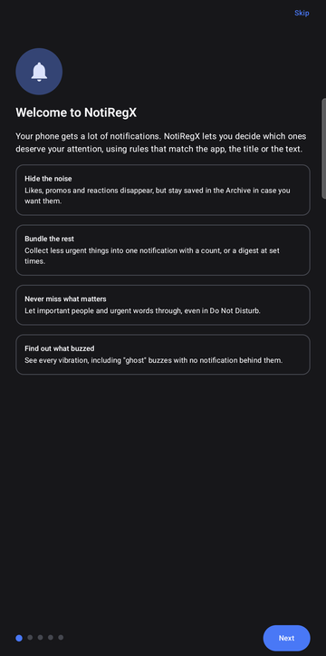
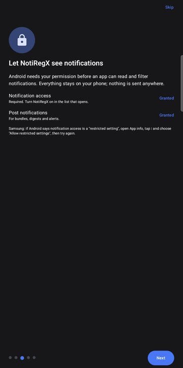
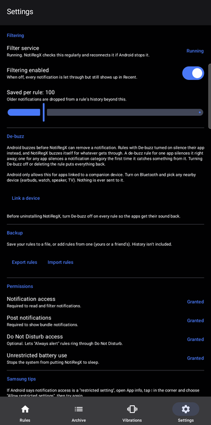

<h1 align="center">NotiRegX</h1>

<p align="center"><b>Rule-based notification filtering for Android.</b><br>
Hide the noise, bundle the rest, never miss what matters, and find out what just buzzed.</p>

<p align="center">
  <a href="https://github.com/Lonezsi/NotiRegX/releases/latest/download/NotiRegX.apk">
    
  </a>
</p>

<p align="center">
  Android 8.0 or newer · tested on a Samsung Galaxy A56 (One UI 8.5, Android 16) ·
  <a href="https://github.com/Lonezsi/NotiRegX/releases">all releases</a>
</p>

<p align="center">
  
  
  
</p>

## What it does

- **Rules with regex.** Match notifications by app and by a pattern in the title, the text, or both.
  Rules run top to bottom and the **last matching rule wins**, so later rules can make exceptions.
- **Four actions:** **Hide** (saved to the archive), **Bundle** (one notification with a count, or a
  digest at set times), **Let through**, and **Always alert** (rings even in Do Not Disturb).
- **Make rules from real notifications.** Tap *Make rule* on anything in the archive and NotiRegX suggests
  patterns based on similar notifications (`# new messages`, `… liked your photo`, …).
- **Learns from your swipes.** Notifications you keep swiping away unread turn into suggested rules.
- **De-buzz.** Stops filtered notifications from vibrating at all, and NotiRegX buzzes for what gets through.
- **Vibration log.** Every buzz, which app caused it, and **ghost vibrations** with no notification behind them.
  Add the *Last buzz* quick-settings tile to check in one tap.
- **Senders.** See who sends you the most, per app, today / this week / this month / ever.
- **Schedules, burst limits, digests, stats, backup/restore of rules**, and a watchdog that keeps the filter running.
- **Languages:** English, Magyar, Deutsch, Español. Pick one in Settings, or follow the phone's language.

Everything stays on your phone. NotiRegX has no internet permission.

## Install

1. Tap the big button above on your phone and open the downloaded `NotiRegX.apk`.
2. If Android asks, allow your browser or file manager to **install unknown apps**.
3. Open NotiRegX and follow the short tutorial. It asks for **notification access**, which it needs to work.
   - On Samsung, if that's shown as a *restricted setting*: open **App info**, tap **⋮**, choose
     **Allow restricted settings**, and try again.
4. Recommended on Samsung: allow **unrestricted battery use** (the tutorial links to it).

To update, download the latest APK and install it over the old one. Your rules and history are kept.

### Optional: ghost vibrations

To see vibrations that come with no notification, grant one extra permission once from a computer with
[adb](https://developer.android.com/tools/adb):

```bash
adb shell pm grant com.notiregx.app android.permission.DUMP
```

## Build from source

Requires JDK 17+ and the Android SDK (platform 36).

```bash
./gradlew assembleRelease
```

The APK ends up in `app/build/outputs/apk/release/`. Run the tests with `./gradlew testDebugUnitTest`.
